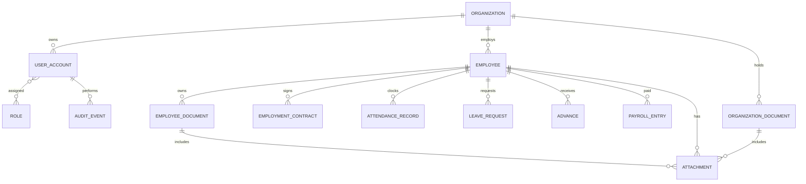

# الملخص التنفيذي والتحليل البصري والهندسي

## الملخص التنفيذي

الصورة تعرض لوحة عربية لنظام موارد بشرية باسم «سيستم الموارد البشرية المتكامل». يتكون قلبها من شبكة 3×3 لوحدات ملونة، يليها صفان من ثمانية مؤشرات KPI، وأسفلها شريط تنقل للوحدات. الهوية المقروءة من الصورة: RTL، عنوان خشبي داكن، خلفية شبكية فاتحة، بطاقات مستطيلة بحواف وظلال، أيقونات خطية بيضاء، ونص عربي عريض. ملف الهوية المرفق يحدد أزرق ركيزة `#1E3A8A` وأخضر `#10B981` وبرتقالي `#F97316` وأحمر `#EF4444` وبنفسجي `#8B5CF6` مع Tajawal/Cairo.

التوصية هي تطبيق ويب React/TypeScript مع API خلفي REST وقاعدة PostgreSQL. يقسم التنفيذ إلى سباقات 2–3 أسابيع: السباق الأول يثبت النظام البصري والهيكل وبيانات تجريبية؛ الثاني يقدم لوحة MVP متجاوبة وتصفح الوحدات؛ ثم سباقات الإنتاج تضيف الموظفين والحضور والإجازات والرواتب والعقود، الصلاحيات والتكاملات والتدقيق. المدة الإجمالية الواقعية لفريق صغير: 7–8 سباقات (14–20 أسبوعاً)، مع MVP قابل للعرض بعد 4–6 أسابيع.

المخاطر الأعلى: غياب شاشات التفاصيل وقواعد العمل من المرجع، حساسية بيانات الرواتب والموظفين، اختلاف الأرقام/الألوان المرصودة عن البيانات الفعلية، والتكاملات الخارجية غير المحددة. ينبغي تثبيت نطاق MVP ومصدر البيانات ومصفوفة الصلاحيات في بداية المشروع.

## 1. التحليل المرئي

### طبقات الصورة

| الطبقة | الوصف المرصود | النوع والحالة | التنفيذ المقترح |
|---|---|---|---|
| خلفية | صفحة فاتحة بنمط مربعات شبكية رمادية دقيقة | ثابتة/زخرفية | لون `#F8FAFC` وشبكة CSS/SVG منخفضة التباين، تعطيلها في الشاشات الصغيرة إن أثرت على القراءة |
| رأس | لوحة خشبية داكنة مستطيلة مستديرة، عنوان أبيض «سيستم الموارد البشرية المتكامل» | ثابت | Header مع عنوان الصفحة وهوية المنتج؛ الخشب أصل زخرفي اختياري، لا صورة خلفية ثقيلة |
| شبكة الوحدات | 9 بطاقات 3 أعمدة × 3 صفوف، أيقونة أعلى/عنوان بالوسط؛ ألوان مختلفة | تكراري/تفاعلي | ModuleCard بلون دلالي، رابط إلى مسار الوحدة، حالات hover/focus/disabled |
| المؤشرات | 8 بطاقات KPI في صفين؛ عنوان، رقم، ووسم KPI وسهم اتجاه | تكراري/عرض بيانات | KpiCard مع قيمة واتجاه وفترة؛ حالات skeleton، empty، stale، error |
| تنقل سفلي | شريط مقسم إلى وحدات: الحاضر، الغياب، العقود، السلف، الملفات والمستندات، المرتبات والحسابات، الإجازات، تقرير ومراقبة، واجهة الدخول | تفاعلي | على الويب المكتبي يمكن تحويله إلى Sidebar/شريط سفلي؛ على الهاتف تبويب سفلي مختصر وقائمة «المزيد» |
| الشعار | شعار «ركيزة Rakeza HR» في أصل مستقل | ثابت | استخدام أصل منفصل؛ الصورة الحالية JPG بخلفية بيضاء وهوامش كبيرة، يلزم قص/تنظيف ثم إخراج SVG/PNG شفاف بعد اعتماد المصدر |

### المحتوى الوظيفي الظاهر

الوحدات: بيانات الموظفين، الحضور والانصراف، الغياب، السلف، الرواتب والحسابات، الإجازات، برمجة النظام، داشبورد التحليلات، عقود الموظفين. المؤشرات: إجمالي الموظفين (30)، الموجودون حالياً (1)، أيام الغياب (56)، أيام الإجازات (104)، إجمالي رواتب الموظفين (7,713)، إجمالي سلف الموظفين (14,000)، العقود المنتهية (8)، متوسط الرواتب (257). هذه أرقام لقطة مرجعية وليست بيانات إنتاج.

### الرموز التصميمية

المصدر الأساسي هو ملف `design/design-tokens.json`. اعتماد Tajawal للنص العربي، Inter للأرقام/اللاتيني. سلم المسافات 4/8/12/16/24/32px؛ radius من 8–12px؛ ظل خفيف للبطاقات. ألوان الوحدة المقترحة تحافظ على ألوان الصورة وتستند إلى دليل العلامة: موظفون كحلي، حضور أخضر، غياب أحمر، سلف رمادي، رواتب برتقالي، إجازات بنفسجي، تطوير أخضر، تحليلات أزرق، عقود خمري. لا تستخدم اللون وحده لنقل الحالة؛ أضف نصاً/أيقونة.

### الأصول المقترحة

| الأصل | الاسم المقترح | الصيغة |
|---|---|---|
| الشعار الأفقي | `brand/rakeza-hr-logo.svg` | SVG مفضل من ملف المتجهات الأصلي؛ وإلا PNG شفاف @1x/@2x بعد إزالة المساحة البيضاء |
| أيقونات الوحدات | `icons/modules/*.svg` | SVG أحادي اللون 24×24، stroke موحد، مصدر Lucide أو مجموعة مرخصة مماثلة |
| نمط الشبكة | `patterns/grid.svg` | SVG صغير قابل للتكرار، تباين منخفض |
| صور الموظفين | `employees/{id}/avatar.webp` | WebP/AVIF مشتق، مع أصل محمي وتحقق MIME والحجم |

## 2. تدفقات الاستخدام والحالات

### التدفقات المرئية والمقترحة

- **فتح لوحة المعلومات:** مصادقة الجلسة → جلب ملخص KPIs والوحدات المسموحة → عرض skeleton → عرض القيم ووقت آخر تحديث. إذا فشل جزء من المؤشرات، تبقى الوحدات متاحة ويظهر تنبيه جزئي مع إعادة المحاولة.
- **فتح وحدة:** النقر/لوحة المفاتيح على البطاقة أو التنقل → تحقق صلاحية → مسار الوحدة → قائمة/ملخص الوحدة. الرجوع يحفظ الفلاتر عند دعمها.
- **بحث وفلترة (موصى به داخل صفحات الوحدات):** إدخال نص وفلاتر → debounce قصير → طلب paginated → تحديث النتائج مع query string. حالات صفر نتائج، مدخلات غير صالحة، انتهاء الجلسة، وفشل الشبكة.
- **إضافة/تعديل/حذف (غير ظاهر بالصورة):** فتح نموذج → تحقق فوري ورسائل عربية → حفظ مع idempotency عند الحاجة → toast وتحديث القائمة. الحذف تأكيدي، مع أرشفة افتراضية للبيانات الوظيفية وسجل تدقيق؛ الحذف النهائي استثناء إداري.
- **دخول/خروج (غير ظاهر بالصورة):** موفر هوية/كلمة مرور وMFA حسب سياسة العميل → إنشاء جلسة آمنة → تدوير/إبطال الجلسة عند الخروج؛ حماية CSRF وcookie HttpOnly/Secure/SameSite.

### الحواف واستجابة الواجهة

انتهاء الجلسة: حفظ المسودة محلياً عند الإمكان ثم طلب الدخول. صلاحية ناقصة: 403 ورسالة لا تكشف معلومات حساسة. قيم KPI غير متاحة: شرطة مع توضيح «غير متاح» لا صفر. بيانات قديمة: إظهار آخر تحديث. التزامن المتعارض: 409 مع إعادة تحميل/دمج. الشبكة: retry محدود وزر يدوي. ملف مرفق خطير/كبير: رفض مع سبب واضح. RTL: اختبار الأرقام اللاتينية/العربية، الاتجاه داخل الحقول، وعرض الجداول على الهاتف.

## 3. البيانات وERD

يوصى بـ PostgreSQL: العلاقات بين المنشأة/الموظف/العقد/الحضور/الإجازة/السلفة/الراتب واضحة، وتحتاج معاملات واتساقاً وتقارير تجميعية. لكل وثيقة موظف سجل مستقل مرتبط بمعرّف الموظف؛ لا نخزن الوثائق كمصفوفة داخل سجل الموظف. تجمع الواجهة هذه السجلات عند العرض مع إبقاء كل وثيقة مستقلة للبحث والتنبيه والتصدير. الملفات الثنائية تحفظ في Object Storage خاص وتخزن البيانات الوصفية في PostgreSQL. استخدم tenant_id منذ البداية، ومبالغ decimal لا float، وتواريخ UTC مع منطقة المنشأة، وفهارس على المؤسسة وتاريخ انتهاء الوثيقة. SQL ابتدائي في `engineering/erd.sql`.

## 4. هندسة التطبيق

### واجهة الويب

React + TypeScript، RTL، React Router، TanStack Query للبيانات البعيدة، React Hook Form + Zod للنماذج. لا حاجة إلى مخزن عام في MVP؛ يضاف Zustand فقط للحالة العابرة المشتركة. فصل `app` و`features` و`shared` و`api`. شجرة الصفحة: `AppShell > Header + Navigation + Main > DashboardPage > ModuleGrid + KpiGrid`. التصميم يعاد تدفقه: 3 أعمدة سطح مكتب، 2 لوحي، عمود هاتف، مع تمرير أفقي محدود للجداول.

### الخلفية

REST API بإصدار `/api/v1`، طبقات routes/controllers → application services → repositories → PostgreSQL. سياسة RBAC مع نطاق مؤسسة، جلسات موثوقة أو OIDC، rate limit، تحقق DTO، سجل تدقيق، ومراقبة أخطاء. التكاملات الخارجية عبر adapters وoutbox/retry idempotent عند الحاجة.

### مثال عقد API

التفاصيل والأمثلة الكاملة في `engineering/openapi.yaml`. النهايات الأولية:

| الطريقة | المسار | الغرض |
|---|---|---|
| GET | `/api/v1/dashboard/summary` | مؤشرات لوحة المعلومات بحسب صلاحية المستخدم |
| GET | `/api/v1/modules` | الوحدات المرئية وترتيبها |
| GET/POST | `/api/v1/employees` | قائمة/إضافة موظف |
| GET/PATCH | `/api/v1/employees/{employeeId}` | عرض/تعديل موظف |
| POST | `/api/v1/leave-requests` | إنشاء طلب إجازة |
| POST | `/api/v1/leave-requests/{id}/decision` | قبول/رفض وفق صلاحية |
| GET | `/api/v1/audit-events` | أحداث التدقيق للمخولين |

أخطاء موحدة: `{code,message,details,traceId}`. أكواد HTTP: 200/201/204، 400/401/403/404/409/422/429/500. OpenAPI يضم المخطط والعينات.

## 5. التنفيذ والاختبار

### تقدير السباقات والأدوار

النقاط تقريبية لفريق محدود (مصمم، واجهة، خلفية، بيانات، QA)؛ تفترض 2 أسابيع للسباق مع مساحة مراجعة.

| السباق | الهدف والتسليم | الأعمال حسب الدور | التقدير |
|---|---|---|---|
| 1 | تثبيت النظام البصري والهيكل وبيانات Dashboard وهمية | التصميم: tokens و3 breakpoints (3–5 أيام). الواجهة: shell/cards/nav RTL (5–8 أيام). الخلفية/البيانات: API mock ونموذج أولي (2–4 أيام). QA: مراجعة التطابق والمتصفحات (2–3 أيام) | 35–50 نقطة؛ 2 أسابيع |
| 2 | MVP قابل للتجربة: لوحة حية، وحدتا موظفين وإجازات بقائمة/نموذج أساسي | واجهة: حالات التحميل والنماذج (6–8 أيام). خلفية/DB: CRUD وصلاحيات أولية (7–10 أيام). تصميم: تدفقات التفاصيل (2–4 أيام). QA: قبول وتكامل وRTL (4–5 أيام) | 40–55 نقطة؛ 2–3 أسابيع |
| 3 | الحضور والغياب والعقود والمرفقات | حضور/تقارير، تخزين آمن، استيراد أولي، تدقيق | 40–55 نقطة؛ 2–3 أسابيع |
| 4 | الرواتب والسلف والإجازات المعتمدة | قواعد الحساب، موافقات، تقارير، اختبارات بيانات | 45–60 نقطة؛ 2–3 أسابيع |
| 5 | الأمان والتكاملات والتهيئة متعددة المؤسسات | SSO/MFA حسب الحاجة، مراقبة، نسخ احتياطي، ترحيل | 35–50 نقطة؛ 2–3 أسابيع |
| 6 | الصلابة والإطلاق | أداء، إتاحة، إصلاحات UAT، runbooks وتدريب | 30–45 نقطة؛ 2 أسابيع |

الإجمالي 14–18 أسبوعاً عند تقليل التوازي/التكاملات، وقد يصل إلى 20 أسبوعاً عند تعقيد الرواتب أو الهوية. MVP العرض في نهاية السباق الأول، وMVP الوظيفي في نهاية الثاني.

### خطة الجودة

- وحدات: تحويلات KPI، صلاحيات الخدمات، قواعد التحقق والحسابات المالية.
- تكامل: API/PostgreSQL، معاملات الموافقات، تخزين الملفات، صلاحيات المستأجر.
- واجهة: حالات التحميل/الفراغ/الخطأ، RTL، 360/768/1440px، لوحة مفاتيح وقارئ شاشة، فرق بصري على نفس أبعاد المرجع.
- قبول مستخدم: سيناريو إنشاء موظف وطلب إجازة ومراجعة المؤشرات، ببيانات اصطناعية.
- أداء: لوحة المعلومات p95 أقل من 500ms على بيانات اختبار ممثلة (حد مبدئي)، قائمة paginated، تحميل lazy للأجزاء الثقيلة، وفحص Core Web Vitals.
- أمن: OWASP Top 10، RBAC وtenant isolation، CSRF/XSS/SQLi، حدود الرفع، سجلات منقحة، اختبار استعادة النسخ الاحتياطية.

## الافتراضات والقرارات المطلوبة لاحقاً

تحتاج مرحلة الاكتشاف تأكيد: وحدات MVP، أدوار المستخدمين، قواعد الرواتب والتقويم/المنطقة، مزود الدخول، أنظمة التكامل، مصدر الموظفين الحالي، وسياسة الاحتفاظ بالبيانات. لا تستنتج اللوحة نفسها قواعد حساب KPI؛ تحفظ هذه كمقاييس معرفة من العميل.
